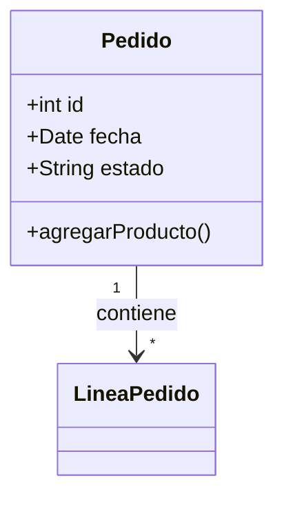

# Modelado UML — Auxiliar Cafetero

Crea diagramas UML en Mermaid que reflejen los requisitos documentados en `docs/01-requisitos/`.

## Proceso

### 1. Elegir el tipo de diagrama

| Tipo | Para qué | Dónde se guarda |
| --- | --- | --- |
| Casos de uso | Actores y lo que hacen (alcance del sistema) | `docs/02-modelado/casos-de-uso.md` |
| Clases | Entidades del dominio, atributos, métodos y relaciones | `docs/02-modelado/diagrama-clases.md` |
| Secuencia | Flujo paso a paso de un caso de uso | `docs/02-modelado/diagramas-secuencia/` |
| Actividad | Flujos con decisiones (ej. preparar un pedido) | `docs/02-modelado/` |
| Estados | Ciclo de vida de un objeto (ej. estado de un pedido) | `docs/02-modelado/` |

### 2. Dibujar en Mermaid

Ejemplo mínimo de clases:

### 3. Revisar antes de guardar

- Nombres en español del dominio, consistentes con los requisitos (Pedido, Producto, Inventario...).
- Multiplicidades (1, *, 0..1) en las asociaciones.
- Solo atributos y métodos relevantes (YAGNI: no añadir lo que no pide el requisito).
- Sintaxis Mermaid válida.

### 4. Guardar

- Un diagrama por archivo en `docs/02-modelado/` (o su subcarpeta correspondiente).
- Nombre descriptivo: `diagrama-clases.md`, `casos-de-uso.md`.
- Al inicio del archivo, referenciar los requisitos que cubre (ej. "Cubre RF-01, RF-03") para la trazabilidad.

## Reglas

- No escribir código de implementación; los diagramas representan el **modelo**, no el código.
- Si falta un requisito necesario para modelar, detenerse y avisar al usuario.
